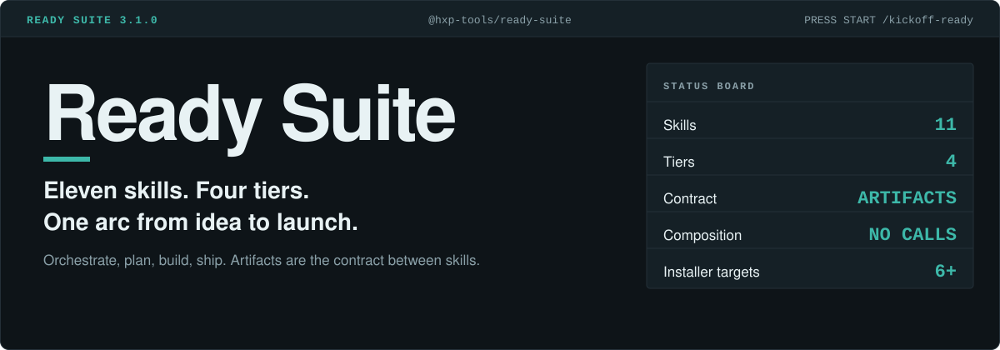
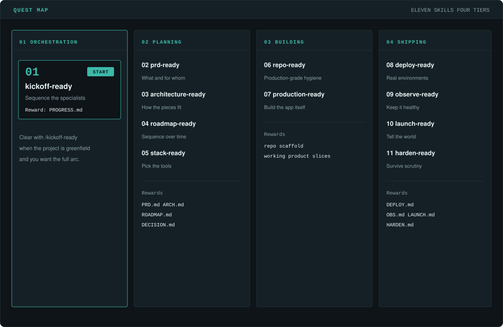
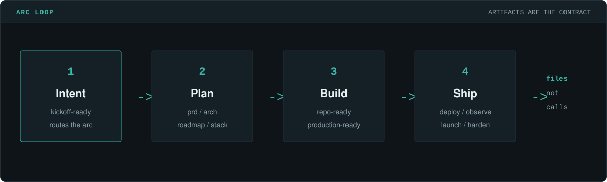

<p align="center">
  
</p>

<p align="center">
  <a href="https://github.com/hannsxpeter/ready-suite/actions/workflows/lint.yml"></a>
  <a href="https://www.npmjs.com/package/@hxp-tools/ready-suite"></a>
  <a href="https://github.com/hannsxpeter/ready-suite/releases/tag/v3.1.0"></a>
  <a href="VERSION"></a>
  <a href="SUITE.md"></a>
  <a href="LICENSE"></a>
</p>

<h3 align="center">Eleven composable AI skills from idea to launch.</h3>

<p align="center"><em>You name the stage. The skill owns it. Artifacts hand the work to the next skill.</em></p>

Implements the [Agent Skills standard](https://agentskills.io). Sibling of [`auditor-suite`](https://github.com/hannsxpeter/auditor-suite). Child distribution: [`arc-ready`](https://github.com/hannsxpeter/arc-ready) (same discipline, one skill).

Ten-minute proof: [Quick Proof](docs/quick-proof.md).

---

## Press start

```bash
npx @hxp-tools/ready-suite@latest
```

That installs every skill into the harnesses it detects (Claude Code, Codex, Cursor, Agent Skills / pi / OpenClaw). Then, inside your agent, clear the first level:

| Host | First run | Then |
|---|---|---|
| Claude Code | `/kickoff-ready` | `/prd-ready`, or jump to the stage you need |
| Codex | `$kickoff-ready` | `$prd-ready` |
| Other slash hosts | `/kickoff-ready` | `/prd-ready` |

Uninstall:

```bash
npx @hxp-tools/ready-suite@latest --uninstall
```

### Claude Code plugin (alternative)

Pick one install method per host. Do not combine `npx` and the plugin on the same Claude Code install.

```text
/plugin marketplace add hannsxpeter/ready-suite
/plugin install ready-suite@ready-suite
```

Want only one skill? `/plugin install prd-ready@ready-suite`.

### From source

```bash
git clone https://github.com/hannsxpeter/ready-suite.git
bash ready-suite/install.sh
```

---

## The quest map

Eleven skills. Four tiers. Run the ones that match where you are; run kickoff-ready when you want the full arc sequenced. Each skill writes artifacts at a known path. Downstream skills read those files. Skills never call each other.

<p align="center">
  
</p>

| Level | Clear it with | Reward |
|---|---|---|
| 1. kickoff-ready | `/kickoff-ready` | `.kickoff-ready/PROGRESS.md` |
| 2. prd-ready | `/prd-ready` | `.prd-ready/PRD.md` |
| 3. architecture-ready | `/architecture-ready` | `.architecture-ready/ARCH.md` |
| 4. roadmap-ready | `/roadmap-ready` | `.roadmap-ready/ROADMAP.md` |
| 5. stack-ready | `/stack-ready` | `.stack-ready/DECISION.md` |
| 6. repo-ready | `/repo-ready` | production-grade repo scaffold |
| 7. production-ready | `/production-ready` | working product slices |
| 8. deploy-ready | `/deploy-ready` | `.deploy-ready/DEPLOY.md` |
| 9. observe-ready | `/observe-ready` | `.observe-ready/OBS.md` |
| 10. launch-ready | `/launch-ready` | `.launch-ready/LAUNCH.md` |
| 11. harden-ready | `/harden-ready` | `.harden-ready/HARDEN.md` |

In Codex the same skills invoke with a `$` prefix: `$kickoff-ready`, `$prd-ready`, and so on.

The game layer is a map, not a scoreboard. There are no points or XP. Progress is the artifact trail on disk.

<details>
<summary>What each skill owns</summary>

| Skill | Tier | One-line purpose |
|---|---|---|
| **[kickoff-ready](skills/kickoff-ready)** | Orchestration | Sequence the ten specialists from raw user intent |
| **[prd-ready](skills/prd-ready)** | Planning | Define what we are building and for whom |
| **[architecture-ready](skills/architecture-ready)** | Planning | Design how the big pieces fit together |
| **[roadmap-ready](skills/roadmap-ready)** | Planning | Sequence work over time |
| **[stack-ready](skills/stack-ready)** | Planning | Pick the right tools for the job |
| **[repo-ready](skills/repo-ready)** | Building | Set up the repo with production-grade hygiene |
| **[production-ready](skills/production-ready)** | Building | Build the app to production grade |
| **[deploy-ready](skills/deploy-ready)** | Shipping | Ship the app to real environments |
| **[observe-ready](skills/observe-ready)** | Shipping | Keep the app healthy once it is live |
| **[launch-ready](skills/launch-ready)** | Shipping | Tell the world the product exists |
| **[harden-ready](skills/harden-ready)** | Shipping | Survive adversarial attention; prove it to an auditor |

Boundaries and known-good versions: [SUITE.md](SUITE.md). Ambiguous triggers: [references/TRIGGER-DISAMBIGUATION.md](references/TRIGGER-DISAMBIGUATION.md).

| Skill | Tier | One-line purpose | Version | Path |
|---|---|---|---|---|
| **kickoff-ready** | Orchestration | Sequence the ten specialists for a greenfield project from raw user intent. | 3.1.0 | [skills/kickoff-ready](skills/kickoff-ready) |
| **prd-ready** | Planning | Define what we're building and for whom. | 3.1.0 | [skills/prd-ready](skills/prd-ready) |
| **architecture-ready** | Planning | Design how the big pieces fit together. | 3.1.0 | [skills/architecture-ready](skills/architecture-ready) |
| **roadmap-ready** | Planning | Sequence work over time. | 3.1.0 | [skills/roadmap-ready](skills/roadmap-ready) |
| **stack-ready** | Planning | Pick the right tools for the job. | 3.1.0 | [skills/stack-ready](skills/stack-ready) |
| **repo-ready** | Building | Set up the repo with production-grade hygiene. | 3.1.0 | [skills/repo-ready](skills/repo-ready) |
| **production-ready** | Building | Build the app to production grade. | 3.1.0 | [skills/production-ready](skills/production-ready) |
| **deploy-ready** | Shipping | Ship the app to real environments. | 3.1.0 | [skills/deploy-ready](skills/deploy-ready) |
| **observe-ready** | Shipping | Keep the app healthy once it's live. | 3.1.0 | [skills/observe-ready](skills/observe-ready) |
| **launch-ready** | Shipping | Tell the world the product exists. | 3.1.0 | [skills/launch-ready](skills/launch-ready) |
| **harden-ready** | Shipping | Survive adversarial attention; prove it to an auditor. | 3.1.0 | [skills/harden-ready](skills/harden-ready) |

</details>

---

## Arc loop

Every skill uses the same composition rule. The harness is the router.

<p align="center">
  
</p>

1. **Intent** names the stage (or kickoff-ready sequences them).
2. **Plan** writes PRD, architecture, roadmap, and stack decisions.
3. **Build** scaffolds the repo and implements production slices.
4. **Ship** deploys, observes, launches, and hardens.
5. **Artifacts** at `.{skill}-ready/*.md` are the only handoff. No skill invokes another.

Orchestrator patterns (GSD, BMAD, Spec Kit, plain harnesses): [ORCHESTRATORS.md](ORCHESTRATORS.md).

---

## Why eleven, not one

A single mega-skill flattens every stage into generic advice. Splitting the work gives each skill room to be opinionated: tight triggers, named failure modes, acceptance gates, and a references library that stays current without bloating the whole suite.

---

## See it end-to-end

A complete dogfood lives at [`examples/ready-suite-example/`](examples/ready-suite-example): all eleven artifacts for a fictional B2B SaaS product, plus [`DOGFOOD.md`](examples/ready-suite-example/DOGFOOD.md).

---

## Developing from this repo

```bash
bash scripts/lint.sh --verbose
npm run pack:check
```

Maintainer rituals: [MAINTAINING.md](MAINTAINING.md). Contributors: [CONTRIBUTING.md](CONTRIBUTING.md). Suite map: [SUITE.md](SUITE.md).

`git pull` updates every installed skill when you installed from a clone, because each harness reads the clone through links. After an `npx` install, re-run `npx @hxp-tools/ready-suite@latest` to refresh `~/.ready-suite` and re-link.

## License

MIT.
